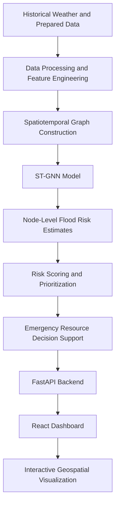

# 🌊 DisasterFlow AI
### Spatiotemporal AI for Urban Flood Prediction & Emergency Resource Allocation

**DisasterFlow AI** is an AI-powered disaster intelligence and decision-support system designed to analyze urban flood risk, identify vulnerable locations, and prioritize emergency resources across Mumbai.

By combining spatiotemporal machine learning, graph-based forecasting, geospatial visualization, and resource allocation logic, the project aims to support faster, more informed decisions during urban flooding events.

> **Project focus:** Predictive flood-risk analysis · Geospatial intelligence · Emergency resource prioritization · AI-powered decision support

---

## 📌 Table of Contents

- [Overview](#-overview)
- [Problem Statement](#-problem-statement)
- [Key Features](#-key-features)
- [System Architecture](#-system-architecture)
- [Technology Stack](#-technology-stack)
- [Machine Learning Approach](#-machine-learning-approach)
- [Dataset](#-dataset)
- [Project Structure](#-project-structure)
- [Getting Started](#-getting-started)
- [Running the Application](#-running-the-application)
- [API Endpoints](#-api-endpoints)
- [Current Limitations](#-current-limitations)
- [Future Enhancements](#-future-enhancements)
- [Disclaimer](#-disclaimer)
- [Author](#-author)

---

## 🌍 Overview

Urban flooding can disrupt transportation, damage infrastructure, threaten vulnerable communities, and delay emergency response.

DisasterFlow AI explores how artificial intelligence and geospatial analytics can help address these challenges by integrating environmental features, flood-related targets, spatial relationships, and emergency resource information into a unified decision-support workflow.

The system is designed around three core questions:

1. **Where is flood risk concentrated?** Analyze spatial and temporal patterns to estimate flood risk.
2. **Which locations need attention first?** Rank locations using risk-related indicators and priority scores.
3. **How can emergency resources be prioritized?** Compare estimated resource requirements with available allocations to support planning.

The project currently uses prepared datasets and model outputs for analysis. It is a research and development prototype, not a validated operational emergency-response system.

---

## 🎯 Problem Statement

Traditional disaster-response planning can be challenged by fragmented data, rapidly changing environmental conditions, and limited emergency resources.

DisasterFlow AI investigates a data-driven approach that combines:

- Historical weather and rainfall information
- Spatial relationships between geographic nodes
- Flood-related features and prediction targets
- Vulnerability and infrastructure-related indicators
- Emergency resource requirements and allocations
- Interactive geospatial visualization

The goal is to transform these inputs into interpretable risk insights and resource-prioritization recommendations.

---

## ✨ Key Features

### 🌧️ Flood Risk Analysis
- Analyze flood-related environmental and spatiotemporal features.
- Generate model-based flood-risk estimates.
- Examine spatial variations across mapped locations.

### 🧠 Spatiotemporal Graph Neural Network
- Represent geographic locations as nodes in a graph.
- Model relationships between connected locations.
- Combine graph-based feature learning with temporal sequence modeling.
- Generate node-level predictions using a graph neural network and GRU-based architecture.

### 🗺️ Geospatial Dashboard
- Visualize geographic nodes and their associated risk information.
- Inspect location-specific prediction and prioritization outputs.
- Explore emergency resource information through an interactive interface.

### 🚑 Emergency Resource Prioritization
- Rank locations using priority-related indicators.
- Compare estimated resource requirements against allocated resources.
- Present decision-support recommendations for further review.

### ⚙️ Backend API
- Serve prediction and prioritization data through a Python API.
- Provide health-check functionality.
- Connect the frontend dashboard to backend outputs.

---

## 🏗️ System Architecture



### Workflow

1. **Data preparation:** Process environmental and spatial datasets into model-ready features.
2. **Feature engineering:** Prepare temporal and spatial representations for learning.
3. **Graph modeling:** Represent locations and their relationships as a graph.
4. **Prediction:** Use the spatiotemporal model to produce node-level estimates.
5. **Prioritization:** Combine relevant outputs with resource-allocation logic.
6. **Visualization:** Expose results through the backend and interactive dashboard.

---

## 🛠️ Technology Stack

| Component | Technologies |
|---|---|
| Programming language | Python, JavaScript |
| Machine learning | PyTorch |
| Graph learning | PyTorch Geometric |
| Temporal modeling | GRU |
| Backend | FastAPI, Uvicorn |
| Frontend | React, Vite |
| Geospatial visualization | Leaflet, React Leaflet |
| Data processing | Pandas, NumPy |
| Data storage | CSV and local model/data files |
| Version control | Git and GitHub |

*The exact dependencies required to run the project are defined by the project's dependency files, where available.*

---

## 🤖 Machine Learning Approach

DisasterFlow AI uses a **Spatiotemporal Graph Neural Network (ST-GNN)** approach to explore how geographic relationships and temporal patterns can contribute to flood-risk estimation.

### Model architecture

The current model design combines:

- **Graph Convolutional Network (GCN):** Learns representations from node features and spatial graph connections.
- **Gated Recurrent Unit (GRU):** Captures temporal patterns in sequences of learned node representations.
- **Linear output layer:** Produces the final node-level model output.

Conceptually:

```text
Input Features
      ↓
Graph Convolution Layer 1
      ↓
Graph Convolution Layer 2
      ↓
GRU Temporal Modeling
      ↓
Linear Prediction Layer
      ↓
Node-Level Output
```

The model is intended to capture both spatial dependencies and temporal behavior rather than treating every geographic location as an independent observation.

**Important:** Prediction quality must be assessed against held-out data using appropriate evaluation metrics, baseline comparisons, and leakage checks before the model can be considered reliable for real-world decisions.

---

## 📊 Dataset

The project uses prepared spatiotemporal datasets and historical weather data associated with the Mumbai urban-flooding use case.

Data categories may include:

- Historical weather and rainfall observations
- Spatial node features
- Flood-related targets
- Training, validation, and test partitions
- Graph-based temporal sequences
- Precomputed node-level prediction outputs

### Data processing considerations

The modeling workflow is designed to support:

- Temporal feature engineering
- Spatial graph construction
- Feature scaling
- Train/validation/test separation
- Node-level prediction generation
- Integration of model outputs with geospatial decision support

### Large dataset files

Some processed datasets and temporal sequence files are too large for ordinary GitHub repository storage and are intentionally excluded from Git commits.

These files must remain available locally, or be obtained from an appropriate storage location, for workflows that depend on them. The application may require specific datasets and trained model files to be present at their expected paths.

**Dataset documentation:** Add the data sources, collection periods, licenses, preprocessing steps, feature definitions, and target-generation methodology here as these are verified.

---

## 📁 Project Structure

```text
DisasterFlow-AI/
│
├── backend/
│   └── FastAPI application and API logic
│
├── data/
│   ├── raw/
│   │   └── Source datasets
│   └── processed/
│       └── Prepared features, targets, and predictions
│
├── docs/
│   └── Project documentation
│
├── frontend/
│   ├── React application
│   ├── Vite configuration
│   └── Geospatial dashboard
│
├── models/
│   └── Machine learning model files
│
├── scripts/
│   └── Data processing and model utilities
│
├── train_stgnn_inspection.txt
├── .gitignore
└── README.md
```

*This is a high-level guide to the repository; individual filenames and components may vary.*

---

## 🚀 Getting Started

### Prerequisites

Install the following before running the application:

- Python 3.10 or a compatible version supported by the project dependencies
- Node.js and npm
- Git
- Required Python packages and frontend dependencies

### 1. Clone the repository

```bash
git clone https://github.com/katkarvismaya19-web/DisasterFlow-AI.git
cd DisasterFlow-AI
```

### 2. Set up the Python environment

On Windows:

```cmd
python -m venv .venv
.venv\Scripts\activate
```

Install the project's Python dependencies using its dependency file, if provided. For example:

```cmd
pip install -r requirements.txt
```

If the repository does not contain `requirements.txt`, install the dependencies specified by the actual backend and model code.

### 3. Install frontend dependencies

```cmd
cd frontend
npm install
cd ..
```

---

## ▶️ Running the Application

Run the backend and frontend in **two separate terminals**.

### Terminal 1: Start the backend

From the project root:

```cmd
python -m uvicorn backend.main:app --host 127.0.0.1 --port 8010 --reload
```

Backend health check:

```text
http://127.0.0.1:8010/health
```

Interactive API documentation, if enabled:

```text
http://127.0.0.1:8010/docs
```

### Terminal 2: Start the frontend

```cmd
cd frontend
npm run dev
```

Open the local URL printed by Vite in your terminal, commonly:

```text
http://localhost:5173
```

### Before running

The backend may depend on local data files and trained model artifacts. Confirm that all required files are present and that the configured paths match your local project structure.

---

## 🔌 API Endpoints

The backend provides endpoints for application health and disaster-related outputs.

| Endpoint | Purpose |
|---|---|
| `/health` | Check backend health and data-loading status |
| `/prediction` | Retrieve prediction summary information |
| `/priorities` | Retrieve emergency-priority information, if available |

Example health-check request:

```bash
curl http://127.0.0.1:8010/health
```

Example prediction request:

```bash
curl http://127.0.0.1:8010/prediction
```

The exact response schemas and endpoint behavior are determined by the current backend implementation. Test the endpoints locally before relying on their outputs.

---

## ⚠️ Current Limitations

- The current project is a prototype and should not be treated as an operational flood-warning system.
- The availability of predictions depends on the prepared data and model artifacts.
- Large datasets are not included in ordinary Git history.
- Historical or prepared inputs do not automatically represent current weather or live flood conditions.
- Resource-prioritization outputs require validation against realistic operational constraints.
- Model accuracy, calibration, generalization, and decision quality require systematic evaluation.
- Live emergency-service, traffic, rainfall, and water-level integrations should not be assumed unless explicitly implemented and tested.

---

## 🔮 Future Enhancements

- Integrate verified real-time rainfall, weather, water-level, and traffic feeds.
- Improve flood-risk calibration and evaluate against strong baseline models.
- Add temporal and spatial validation across different locations and periods.
- Introduce explainable AI for location-level risk factors.
- Incorporate road-network accessibility and emergency response travel times.
- Develop constrained optimization for ambulance, food, water, and medical-resource allocation.
- Add model monitoring, automated testing, and reproducible data pipelines.
- Deploy the backend and dashboard with secure configuration and scalable infrastructure.
- Publish dataset documentation, model evaluation results, and reproducible experiments.

---

## 🛡️ Disclaimer

DisasterFlow AI is an academic and technical prototype developed to explore AI-driven urban flood analysis and emergency resource prioritization.

Its outputs are for research, demonstration, and decision-support exploration only. They must not be used as the sole basis for emergency dispatch, evacuation, medical response, or other safety-critical decisions.

---

## 👩‍💻 Author

**Vismaya Katkar**

GitHub: [@katkarvismaya19-web](https://github.com/katkarvismaya19-web)

Project repository: [DisasterFlow-AI](https://github.com/katkarvismaya19-web/DisasterFlow-AI)

---

⭐ If you find this project interesting, consider starring the repository.

**DisasterFlow AI — Turning spatiotemporal data into actionable disaster intelligence.**

